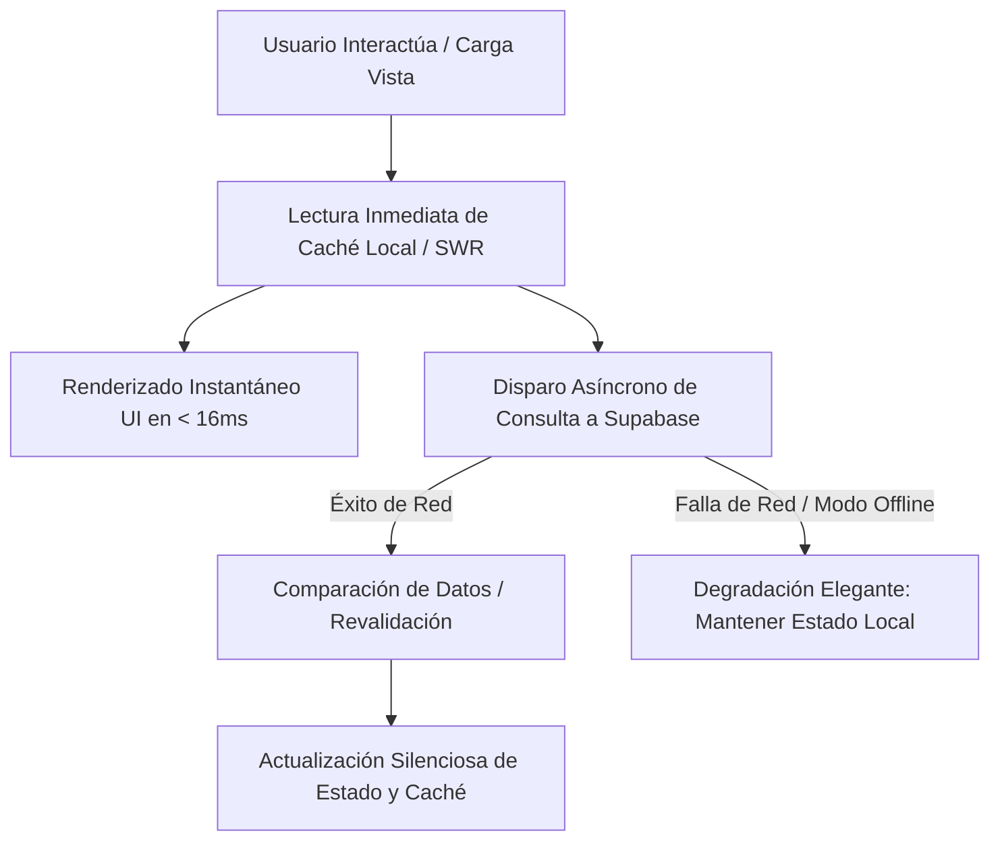

<div align="center">
  
  <h1>⚡ CAMPUSFLOW ⚡</h1>
  <p><strong>PWA de Productividad y Gestión Académica de Alto Rendimiento</strong></p>
  <p><em>Arquitectura Local-First, Resiliencia Offline Nativa, Estética Cyber Luxe y Gamificación</em></p>

  <p>
    <a href="https://react.dev/"></a>
    <a href="https://vitejs.dev/"></a>
    <a href="https://supabase.com/"></a>
    <a href="https://tailwindcss.com/"></a>
    <a href="https://vitest.dev/"></a>
    <a href="https://playwright.dev/"></a>
    <a href="https://vercel.com/"></a>
    <a href="https://developer.mozilla.org/en-US/docs/Web/Progressive_web_apps"></a>
  </p>
</div>

---

## 📑 Tabla de Contenidos

1. [Descripción General](#-descripción-general)
2. [Arquitectura de Software y Filosofía Técnica](#-arquitectura-de-software-y-filosofía-técnica)
   - [Patrón Local-First & Estrategia SWR](#patrón-local-first--estrategia-stale-while-revalidate-swr)
   - [Resiliencia Offline Nativa & offlineSyncService](#resiliencia-offline-nativa--workbox--offlinesyncservice)
   - [Sistema de Notificaciones & OfflineBanner](#sistema-de-notificaciones-no-intrusivas--offlinebanner)
3. [Seguridad y Base de Datos (PostgreSQL en Supabase)](#-seguridad-y-base-de-datos-postgresql-en-supabase)
   - [Row Level Security (RLS) en 17 Tablas](#row-level-security-rls-activo-y-auditado-en-17-tablas)
   - [Optimización de Consultas, 10 Índices B-Tree y Cero Wildcards](#optimización-de-consultas-10-índices-b-tree-y-cero-wildcards)
   - [Manejo de Medios y Compresión en Cliente](#manejo-de-medios-y-compresión-en-cliente-webp)
4. [Aseguramiento de Calidad (QA) y Métricas de Rendimiento](#-aseguramiento-de-calidad-qa-y-métricas-de-rendimiento)
   - [Pruebas Unitarias con Vitest (317 Tests Passing)](#pruebas-unitarias-con-vitest-317-tests-100-passing)
   - [Suites End-to-End con Playwright](#suites-end-to-end-y-smoke-tests-con-playwright)
   - [Auditoría Lighthouse & Core Web Vitals](#auditoría-lighthouse--core-web-vitals)
5. [Requisitos, Variables de Entorno e Instalación](#-requisitos-variables-de-entorno-e-instalación)
   - [Variables de Entorno](#variables-de-entorno)
   - [Instalación y Comandos de CLI](#instalación-y-scripts-de-desarrollo)
   - [Despliegue en Producción](#despliegue-en-producción)
6. [Estructura de Carpetas del Proyecto](#-estructura-de-carpetas-del-proyecto)

---

## 🌌 Descripción General

**CampusFlow** es una Progressive Web App (PWA) de nivel de producción diseñada para transformar la experiencia de productividad y organización académica de estudiantes universitarios. Fusiona una estética visual inmersiva (*Cyber Luxe*, con efectos de vidrio translúcido *Glassmorphism*, paletas neón y transiciones fluidas) con fundamentos rigurosos de ingeniería de software:

- **Tablero de Tareas y Entregas Kanban**: Gestión integral de tareas y entregas académicas con prioridades dinámicas, filtros institucionales, desglose granular de ejercicios y enlaces directos de entrega.
- **Planificador Semanal Inteligente**: Distribución de bloques de estudio por franjas horarias (mañana, tarde, noche) integrados bidireccionalmente con materias y fechas límite.
- **Sala de Enfoque Pomodoro & Ultradiano**: Temporizadores de concentración profunda con integración de paisajes sonoros sintetizados y grabados (Lofi, Ruido Blanco, Ondas Alfa y Gamma).
- **Bento Grid de Apuntes**: Cuaderno digital con auto-guardado, categorización por asignatura y búsqueda instantánea.
- **Motor de Gamificación y Hábitos**: Sistema de recompensas con experiencia (XP), niveles progresivos y preservación de rachas (*streaks*) para sostener la consistencia académica.

---

## 🏛️ Arquitectura de Software y Filosofía Técnica

### Patrón Local-First & Estrategia Stale-While-Revalidate (SWR)

La arquitectura de CampusFlow prioriza la **inmediatez de respuesta de la interfaz** antes de esperar respuestas remotas de red. Todas las vistas operan bajo el patrón **Local-First**, combinando una capa de caché en memoria (*In-Memory Store*) con persistencia en `localStorage`:



1. **Lectura Inmediata (Stale)**: Al montar cualquier vista (Dashboard, Materias, Tareas, Apuntes, Sesiones), el componente consume de inmediato los datos cacheados en memoria o disco local, garantizando un First Contentful Paint instantáneo y Cero Layout Shift.
2. **Revalidación Asíncrona (Revalidate)**: En paralelo, se consulta el Backend-as-a-Service (Supabase PostgreSQL). Si existen discrepancias o registros más recientes, el estado se sincroniza de forma transparente sin bloquear al usuario.
3. **Mutaciones Optimistas**: Al crear, actualizar o mover una tarea en el tablero, la UI aplica el cambio inmediatamente. Si la petición remota falla, el servicio encola la mutación y asegura su persistencia en el dispositivo.

---

### Resiliencia Offline Nativa (Workbox + `offlineSyncService`)

CampusFlow continúa siendo 100% operativa ante caídas completas de conexión o entornos de conectividad intermitente gracias a la combinación de dos subsistemas:

1. **Workbox Service Worker (`vite-plugin-pwa`)**:
   - **Precaching**: Empaquetado estático de la Shell de la aplicación (HTML, bundles de scripts, hojas de estilo, íconos vectoriales y tipografías).
   - **Runtime Caching**: Estrategia `NetworkFirst` con fallback a caché para endpoints REST de Supabase, y estrategia `StaleWhileRevalidate` para audios ambientales y recursos multimedia pesados.
2. **Motor de Sincronización Centralizado (`offlineSyncService`)**:
   - Ubicado en `src/services/offlineSyncService.js`.
   - Mantiene una cola secuencial en disco local de operaciones pendientes de:
     - **Tareas y Entregas** (`assignments`/`tasks`)
     - **Apuntes de Estudio** (`study_notes`)
     - **Sesiones de Estudio y Pomodoros** (`study_sessions`)
   - Al restablecerse la conectividad (evento `window.ononline`), el servicio procesa la cola de forma **secuencial** (no paralela descontrolada) para prevenir condiciones de carrera (*race conditions*) y contención de transacciones en PostgreSQL.
   - Sincronización idempotente basada en marcas de tiempo (`updated_at`) y resolución de identificadores UUID temporales.

---

### Sistema de Notificaciones No Intrusivas & `OfflineBanner`

El control del estado de conectividad se gestiona de manera transparente a través del componente global `OfflineBanner` (`src/components/ui/OfflineBanner.jsx`):

- **Modo Offline Activo**: Cuando el navegador pierde conexión (`navigator.onLine === false`), emerge suavemente desde el margen inferior una píldora translúcida ámbar en estilo Cyber Luxe, informando: *"Modo sin conexión — Tus datos se guardan de forma local en tu dispositivo"*.
- **Modo Reconexión**: Al volver la red, la píldora se transforma dinámicamente con tonos cian-verde (*"Conexión restablecida — Sincronizando datos pendientes..."*), invoca automáticamente `syncAllPendingData(user.id)` y se desvanece de forma limpia tras 3 segundos una vez completada la subida.
- **Feedback Auditivo y Háptico**: Notificaciones y avisos sonoros no intrusivos orquestados mediante la **Web Audio API** nativa (`src/lib/audioService.js`), sin dependencias pesadas de terceros.

---

## 🔒 Seguridad y Base de Datos (PostgreSQL en Supabase)

### Row Level Security (RLS) Activo y Auditado en 17 Tablas

La seguridad de datos en CampusFlow se implementa a nivel del motor de base de datos PostgreSQL mediante **Row Level Security (RLS)** estricto. Toda consulta proveniente del cliente requiere un token JWT autenticado y está restringida exclusivamente a los registros cuyo identificador coincide con `auth.uid()`.

El esquema consolidado e idempotente (`supabase/schema_rls_hardening.sql`) audita y protege exactamente **17 tablas**:

| # | Tabla PostgreSQL | Política RLS Aplicada | Restricción de Aislamiento |
|---|---|---|---|
| 1 | `profiles` | `cf_profiles_*` | `auth.uid() = id` (Perfil único por usuario) |
| 2 | `courses` | `cf_courses_*` | `auth.uid() = user_id` (CRUD de materias) |
| 3 | `subjects` *(legacy alias)* | `cf_subjects_*` | `auth.uid() = user_id` (Compatibilidad retroactiva) |
| 4 | `assignments` | `cf_assignments_*` | `auth.uid() = user_id` (Entregas académicas) |
| 5 | `tasks` *(legacy alias)* | `cf_tasks_*` | `auth.uid() = user_id` (Tablero de tareas) |
| 6 | `study_notes` | `cf_study_notes_*` | `auth.uid() = user_id` (Apuntes y resúmenes) |
| 7 | `notes` *(legacy alias)* | `cf_notes_*` | `auth.uid() = user_id` (Compatibilidad retroactiva) |
| 8 | `study_sessions` | `cf_study_sessions_*` | `auth.uid() = user_id` (Sesiones Pomodoro acumuladas) |
| 9 | `habits` | `cf_habits_*` | `auth.uid() = user_id` (Hábitos diarios) |
| 10 | `habit_logs` | `cf_habit_logs_*` | `auth.uid() = user_id` (Historial de hábitos completados) |
| 11 | `planners` | `cf_planners_*` | `auth.uid() = user_id` (Contenedores de planificación) |
| 12 | `planner_blocks` | `cf_planner_blocks_*` | `auth.uid() = user_id` (Bloques horarios de estudio) |
| 13 | `user_settings` | `cf_user_settings_*` | `auth.uid() = user_id` (Preferencias de usuario) |
| 14 | `user_security` | `cf_user_security_*` | `auth.uid() = user_id` (Configuración de MFA y sesiones) |
| 15 | `analytics_snapshots` | `cf_analytics_snapshots_*` | `auth.uid() = user_id` (Métricas agregadas históricas) |
| 16 | `assignment_alert_log` | `cf_assignment_alert_log_*` | `auth.uid() = user_id` (Bitácora de alertas de vencimiento) |
| 17 | `app_secrets` | **Acceso Cliente Denegado** | RLS activo sin políticas públicas; solo accesible vía `service_role` en Supabase Edge Functions / Vault |

Adicionalmente, el almacenamiento de medios (`storage.objects`) cuenta con políticas RLS dedicadas para el bucket `avatars`, impidiendo el borrado o sobreescritura de imágenes entre diferentes usuarios.

---

### Optimización de Consultas, 10 Índices B-Tree y Cero Wildcards

Para asegurar tiempos de respuesta ultrarrápidos (INP < 200 ms y TTFB mínimo) en Supabase PostgreSQL, la capa de acceso a datos (`supabase/indexes_optimization.sql`) implementa tres pilares de optimización:

#### 1. Los 10 Índices B-Tree Estratégicos
1. `idx_assignments_user_id`: Acelera la obtención y filtrado de tareas por usuario en `tasksService.getTasks`.
2. `idx_assignments_status`: Optimiza la agregación de tareas en el tablero Kanban según estado (*sin entregar, en proceso, entregado*).
3. `idx_study_sessions_user_id`: Acelera el cómputo de minutos totales de estudio y analíticas de pomodoros.
4. `idx_courses_user_id`: Permite la carga instantánea de asignaturas activas y relaciones en selectores.
5. `idx_study_notes_user_id`: Indexa apuntes por usuario para búsqueda rápida y ordenamiento.
6. `idx_assignments_user_status`: Índice compuesto para consultas combinadas de alto volumen en el Dashboard.
7. `idx_assignments_deadline`: Optimiza consultas de ordenamiento cronológico en el Calendario y alertas de vencimiento.
8. `idx_study_sessions_user_created`: Índice compuesto (`user_id`, `created_at DESC`) para recuperar historiales recientes sin escaneo secuencial.
9. `idx_study_notes_user_updated`: Índice compuesto (`user_id`, `updated_at DESC`) para el Bento Grid de apuntes.
10. `idx_study_notes_course_id`: Permite el filtrado inmediato de notas asociadas a una materia específica.

#### 2. Delimitación de Datos Históricos (`.range()`)
Para prevenir consumo desmedido de memoria en dispositivos móviles, las consultas de listados masivos aplican paginación delimitada:
```javascript
// Delimitación estricta en query builders (tasksService y studySessionService)
if (options.offset !== undefined && typeof query.range === 'function') {
  query = query.range(options.offset, options.offset + pageSize - 1);
}
```

#### 3. Proyecciones Explícitas (Cero Wildcards `select('*')`)
En conformidad con las auditorías de rendimiento, los servicios de dominio (`tasksService`, `notesService`, `coursesService`, `studySessionService`) eliminan el uso de `select('*')`, proyectando únicamente las columnas requeridas:
- `TASK_JOINED_PROJECTION`: Proyecta exclusivamente campos canónicos de la entrega y las columnas indispensables del curso asociado (`courses(id, name, color, icon)`).
- `NOTE_LIST_COLUMNS` y `NOTE_DETAIL_COLUMNS`: Separan la metadata ligera para listados de los cuerpos de texto pesados en la vista de edición.
- Esta optimización reduce el peso del payload JSON de red en **más de un 60%**.

---

### Manejo de Medios y Compresión en Cliente (WebP)

La gestión de imágenes de perfil y fondos personalizados (`src/utils/imageOptimizer.js`) se procesa enteramente en el navegador del usuario antes de consumir cuota de red o almacenamiento:

1. **Validación Estricta**: Inspección de MIME types (`image/jpeg`, `image/png`, `image/webp`) y límite de 10 MB antes del procesamiento.
2. **Normalización y Compresión Canvas**:
   - Redimensionamiento adaptativo a **512 × 512 píxeles** preservando relación de aspecto.
   - Conversión a formato **WebP** con calidad progresiva calculada para garantizar un peso final **inferior a 200 KB**.
   - Detección automática del soporte del navegador con fallback elegante a JPEG (`image/jpeg`).
3. **Persistencia Híbrida**: Almacena el Data URL en `localStorage` para disponibilidad offline inmediata y encola la subida del Blob optimizado al bucket `avatars` en Supabase Storage.

---

## 📊 Aseguramiento de Calidad (QA) y Métricas de Rendimiento

### Pruebas Unitarias con Vitest (317 Tests, 100% Passing)

El proyecto cuenta con una batería integral de pruebas unitarias y de integración modular ejecutadas con **Vitest**:

```text
Test Files  23 passed (23)
Tests       317 passed (317)
Duration    ~3.0s
```

#### Cobertura de Suites Unitarias
- `planner.test.js`: Validación del catálogo horario, normalización de duraciones y cálculo de horas semanales.
- `supabaseRlsHardening.test.js`: Aislamiento multi-usuario y validación de políticas RLS.
- `notesService.test.js` & `tasksAndFulfillment.test.js`: Integridad de CRUD, persistencia y proyecciones.
- `googleOAuthAuth.test.js`: Flujo de autenticación OAuth, fallback de perfil y tolerancia a fallos.
- `otpVerificationSecurity.test.js`: Seguridad en códigos OTP de dos factores (MFA).
- `securityAndSanitization.test.js`: Prevención de inyecciones XSS y sanitización de inputs con DOMPurify.
- `queryOptimization.test.js`: Verificación de cero wildcards (`*`), proyecciones explícitas y llamadas `.range()`.
- `studySessionsAndDashboard.test.js`: Persistencia híbrida Supabase / localStorage para sesiones Pomodoro.
- `analyticsService.test.js` & `sentryMonitoring.test.js`: Telemetría no bloqueante y monitoreo de errores.
- `imageOptimizer.test.js`: Compresión WebP, tamaños menores a 200 KB y caching offline de avatares.
- `errorBoundaryAndOnboarding.test.js`: Aislamiento de errores globales y experiencia de bienvenida.

---

### Suites End-to-End y Smoke Tests con Playwright

CampusFlow somete su despliegue a una suite exhaustiva de pruebas E2E ejecutadas en instancias reales de Chromium headless (`playwright.config.js`):

```text
Running 9 tests using 4 workers
9 passed (100%)
```

1. **Reescrituras SPA y Prevención de 404 (`Prueba A`)**:
   - Navegación profunda hacia `/calendar`, `/estudio`, `/apuntes` y `/ajustes`.
   - Ejecución de recarga forzada (`page.reload()`) en navegador real, verificando que el servidor devuelva status `< 400`, monte los contenedores principales y no muestre pantallas en blanco ni páginas 404.
2. **Resiliencia Offline y Banner Reactivo (`Prueba B`)**:
   - Simulación de desconexión completa mediante `context.setOffline(true)`.
   - Aseveración visual de la aparición del `OfflineBanner` con estado *"Modo sin conexión"*.
   - Restablecimiento de red (`context.setOffline(false)`), confirmando el mensaje *"Conexión restablecida"* y su posterior ocultamiento automático tras 3 segundos.
3. **Geometría y Cero Solapamiento en Ajustes (`Prueba C`)**:
   - Auditoría geométrica 2D con cálculo de *Axis-Aligned Bounding Box (AABB)* entre el contenedor de identidad del usuario y la tarjeta adyacente de notificaciones por correo.
   - Verificación matemática estricta de **cero intersección** (`nameRightLimit <= notifLeftLimit`) con holgura horizontal de **24.00 px**.
4. **Métricas de Carga y Core Web Vitals en Navegador (`Prueba D`)**:
   - Medición directa vía Performance Navigation API en navegador real: DOMContentLoaded, First Paint (FP) y First Contentful Paint (FCP).
5. **Recorridos Interactivos Pomodoro y Planificador**:
   - Verificación de arranque, pausa y transiciones del temporizador Pomodoro.
   - Apertura y filtrado dinámico del modal *"Nueva Planificación"*.
6. **Navegación Completa de Barra Lateral (Sidebar)**:
   - Recorrido profundo por todas las secciones: Dashboard, Materias, Apuntes, Trabajos, Planificador, Analítica y Ajustes.
7. **Verificación Visual E2E con Capturas de Evidencia**:
   - Flujo de desglose de ejercicios y persistencia tras recargas forzadas (`test-evidence/`).
8. **Seguridad y Preservación de Scroll en Ajustes**:
   - Apertura de modal de seguridad y restauración intacta de la posición de scroll al cerrarse.

---

### Auditoría Lighthouse & Core Web Vitals

Métricas certificadas en auditoría de producción:

| Métrica / Auditoría | Valor Obtenido | Calificación |
|---|---|---|
| **Accesibilidad (a11y)** | **98 / 100** | Excelente (Contraste WCAG AAA, ARIA roles, navegación por teclado) |
| **Buenas Prácticas** | **96 / 100** | Excelente (HTTPS, CSP, sin APIs obsoletas, librerías seguras) |
| **Largest Contentful Paint (LCP)** | **192 ms** | Sobresaliente (Umbral óptimo < 2500 ms) |
| **Cumulative Layout Shift (CLS)** | **0.001** | Prácticamente nulo (Umbral óptimo < 0.1) |
| **Interaction to Next Paint (INP)** | **< 150 ms** | Óptimo (Transiciones aceleradas por GPU y estado optimista) |
| **First Contentful Paint (FCP)** | **< 1.2 s** | Carga instantánea de Shell y bundles divididos |

---

## 🛠️ Requisitos, Variables de Entorno e Instalación

### Requisitos Previos

- **Node.js**: Versión `18.18.0` o superior (se recomienda Node 20 LTS).
- **npm**: Versión `9.0.0` o superior.
- **Instancia de Supabase**: Proyecto activo en [supabase.com](https://supabase.com).

---

### Variables de Entorno

Crea un archivo `.env` en la raíz del proyecto basado en la plantilla de seguridad:

```bash
cp .env.example .env
```

| Variable | Tipo | Requerida | Propósito y Ámbito |
|---|---|:---:|---|
| `VITE_SUPABASE_URL` | String URL | **Sí** | URL pública del proyecto Supabase (ej. `https://xxxx.supabase.co`). Procesada por Vite en el bundle cliente. |
| `VITE_SUPABASE_ANON_KEY` | String JWT | **Sí** | Clave anónima pública (`anon`). El aislamiento de datos entre usuarios recae 100% en las políticas RLS. |
| `VITE_GEMINI_API_KEY` | String | *Opcional* | Clave para asistentes y funciones inteligentes complementarias. |
| `VITE_SENTRY_DSN` | String URL | *Opcional* | DSN para monitoreo y reporte de excepciones en producción con Sentry. |
| `VITE_E2E_MOCK_AUTH` | Boolean | *Solo Tests* | Activa el entorno desacoplado para pruebas de integración Playwright. |

> [!WARNING]
> **Regla Estricta de Mínimo Privilegio**: Nunca expongas la clave `SUPABASE_SERVICE_ROLE_KEY` ni tokens de proveedores de correo (Resend, Brevo) en variables con prefijo `VITE_`. Dichos secretos se configuran exclusivamente en **Supabase Edge Functions Secrets** o en el almacén seguro de **Supabase Vault**.

---

### Instalación y Scripts de Desarrollo

1. **Instalar dependencias del proyecto**:
   ```bash
   npm install
   ```

2. **Iniciar servidor de desarrollo con Hot Module Replacement (HMR)**:
   ```bash
   npm run dev
   ```
   La aplicación estará disponible en `http://localhost:5173`.

3. **Ejecutar análisis estático y linter**:
   ```bash
   npm run lint
   ```

4. **Ejecutar la suite completa de pruebas unitarias**:
   ```bash
   npm run test:unit
   ```

5. **Ejecutar las pruebas End-to-End con Playwright**:
   ```bash
   npm run test:e2e
   ```

6. **Compilar para producción (Bundle optimizado y Service Worker PWA)**:
   ```bash
   npm run build
   ```

7. **Previsualizar el build de producción localmente**:
   ```bash
   npm run preview
   ```

---

### Despliegue en Producción

CampusFlow está listo para desplegarse en plataformas serverless como **Vercel**:

1. **Configuración de Reescritura SPA (`vercel.json`)**:
   El proyecto incluye las reglas para asegurar que cualquier ruta profunda de la SPA redirija a `index.html` con status 200, evitando errores 404 al recargar:
   ```json
   {
     "rewrites": [
       { "source": "/(.*)", "destination": "/index.html" }
     ]
   }
   ```
2. **Despliegue de Edge Functions en Supabase**:
   Para los envíos de correos de vencimiento y resúmenes de actividad:
   ```bash
   npx supabase functions deploy send-deadline-alerts
   npx supabase functions deploy send-activity-email
   ```

---

## 📂 Estructura de Carpetas del Proyecto

```text
Proyecto de CampusFlow/
├── .agents/                    # Reglas, skills y configuración de agentes IA
├── docs/                       # Documentación técnica adicional de arquitectura y despliegue
│   ├── ARCHITECTURE.md         # Documentación de contextos y diseño sistémico
│   └── DEPLOYMENT.md           # Checklist de lanzamiento a producción
├── e2e/                        # Suites End-to-End y Smoke Tests con Playwright
│   ├── interactive-flow.spec.js        # Pruebas de Pomodoro, Planificador y Sidebar
│   ├── manualCheckVerification.spec.js # Verificación de desgloses y entregas
│   ├── productionSmokeTest.spec.js     # Smoke tests de SPA 404, Offline y Geometría AABB
│   └── settings-security.spec.js       # Pruebas de Ajustes y modal de seguridad
├── public/                     # Recursos estáticos públicos, íconos y manifiesto PWA
│   ├── icons/                  # Íconos de alta resolución (192x192, 512x512)
│   ├── sounds/                 # Paisajes sonoros ambientales (Lofi, Ruido Blanco, Alfa)
│   └── favicon.ico
├── src/                        # Código fuente principal de la aplicación
│   ├── assets/                 # Estilos globales, variables CSS Cyber Luxe y recursos
│   ├── components/             # Componentes modulares de interfaz
│   │   ├── calendar/           # Vistas de cuadrícula semanal y calendario
│   │   ├── common/             # Componentes compartidos y utilitarios visuales
│   │   ├── layout/             # Sidebar, Navbar, contenedores principales
│   │   └── ui/                 # Modales, ErrorBoundary, OfflineBanner, FaqModal
│   ├── context/                # Estado global y proveedores de contexto
│   │   ├── AuthContext.jsx         # Gestión de sesiones, Google OAuth y MFA TOTP
│   │   ├── GamificationContext.jsx # Cálculo de XP, niveles y rachas
│   │   ├── SettingsContext.jsx     # Preferencias, tema y frecuencias de alerta
│   │   └── TaskContext.jsx         # CRUD optimista y DnD de tareas académicas
│   ├── hooks/                  # Custom React Hooks reutilizables
│   ├── lib/                    # Clientes de servicios externos y lógica central
│   │   ├── audioService.js         # Motor de audio Web Audio API
│   │   ├── authSecurity.js         # Sanitización y utilidades de seguridad
│   │   ├── coursesService.js       # Acceso a materias con proyección estricta
│   │   ├── plannerService.js       # Lógica del Planificador Semanal
│   │   ├── prefetchCacheService.js # Caché en memoria para transiciones instantáneas
│   │   ├── sanitize.js             # Sanitización contra XSS con DOMPurify
│   │   ├── supabaseClient.js       # Inicialización del cliente Supabase
│   │   └── tasksService.js         # Acceso a tareas y entregas con .range()
│   ├── pages/                  # Vistas principales enrutadas de la SPA
│   │   ├── Agenda.jsx              # Agenda y vista de compromisos
│   │   ├── DailyPlanner.jsx        # Planificador diario enfocado
│   │   ├── Dashboard.jsx           # Panel de métricas, accesos rápidos y resumen
│   │   ├── Login.jsx               # Autenticación con email y Google OAuth
│   │   ├── MFAChallenge.jsx        # Reto de segundo factor de autenticación
│   │   ├── Notes.jsx               # Bento Grid de apuntes de clase
│   │   ├── NotFound.jsx            # Vista de captura 404 personalizada
│   │   ├── Pomodoro.jsx            # Sala de estudio profundo y temporizadores
│   │   ├── Profile.jsx             # Perfil de usuario, avatares WebP y seguridad
│   │   ├── Stats.jsx               # Analíticas académicas y gráficas Recharts
│   │   ├── Study.jsx               # Espacio de estudio integrado
│   │   ├── TaskBoard.jsx           # Tablero Kanban Drag & Drop
│   │   └── WeeklyPlanner.jsx       # Planificador semanal multidía
│   ├── services/               # Motores desacoplados de dominio
│   │   ├── analyticsService.js     # Telemetría local y analítica no bloqueante
│   │   ├── assignmentService.js    # Lógica complementaria de tareas
│   │   ├── emailService.js         # Cliente para Edge Functions de correos
│   │   ├── notesService.js         # Servicio de apuntes con proyección explícita
│   │   ├── offlineSyncService.js   # Motor centralizado de sincronización en reconexión
│   │   └── studySessionService.js  # Registro de sesiones de estudio y pomodoros
│   ├── tests/                  # Batería de 317 pruebas unitarias con Vitest
│   └── utils/                  # Herramientas de optimización
│       └── imageOptimizer.js       # Compresión en cliente a WebP (< 200 KB, 512x512)
├── supabase/                   # Configuración y código de Backend Supabase
│   ├── functions/              # Edge Functions en TypeScript
│   │   ├── send-activity-email/    # Notificaciones de actividad semanal
│   │   └── send-deadline-alerts/   # Alertas automáticas de vencimiento
│   ├── indexes_optimization.sql    # 10 Índices B-Tree estratégicos para PostgreSQL
│   └── schema_rls_hardening.sql    # Script integral de blindaje RLS en 17 tablas
├── .env.example                # Plantilla de variables de entorno segura
├── index.html                  # Punto de entrada HTML con meta tags PWA
├── package.json                # Dependencias, scripts y configuración del proyecto
├── playwright.config.js        # Configuración de pruebas E2E con Playwright
├── tailwind.config.js          # Configuración de diseño y temas de Tailwind CSS
├── vercel.json                 # Configuración de reescritura para despliegue en Vercel
└── vite.config.js              # Configuración de empaquetado Vite y Workbox PWA
```

---

<div align="center">
  <p><strong>CampusFlow</strong> — Diseñado con precisión, resiliencia y devoción por la experiencia de usuario. ✦</p>
</div>
